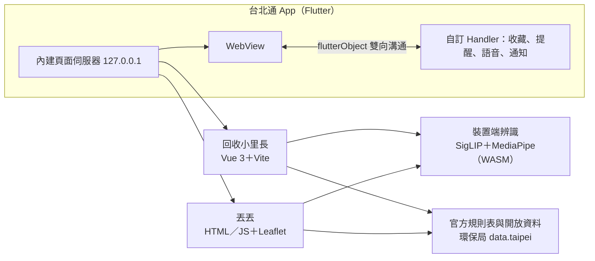

# 回收小里長＋丟丟 TossTalk


2026 臺北秋季程式設計節・城市通微服務大黑客松作品。本 repo 是台北通（TownPass）的 fork，加上兩個微服務；原本的台北通說明在本頁最下方。

## 專案簡介 / Project Overview

**主題：看不懂 #理解限制**

臺北的垃圾規則寫得很清楚：一般垃圾要用專用袋、週三週日停收、平面和立體回收分不同天、垃圾不落地。問題是，**看得懂這些規則的前提是會讀中文、看得懂分類名詞、會操作層層選單**。我們把同一套官方規則，做成不用讀懂也能照著做的服務。

### 我們解決誰的痛點 / Whose Problem We Solve

| 對象 | 卡在哪裡 | 我們怎麼做 | 對應方向 |
|---|---|---|---|
| **外籍人士・新住民** | 規則和母國不同，資訊幾乎只有中文；不知道垃圾車幾點、在哪裡等，也看不懂「立體類」「平面類」 | **丟丟**：8 種語言；用母語說話或打字問；「今晚要丟什麼」勾一勾，一次一步帶著做；垃圾車停靠點地圖與到站前提醒 | 多語服務、易讀設計 |
| **兒童** | 分類名詞抽象、字多，大人也常說不清楚為什麼 | **回收小里長**：孩童專屬介面，每個國字都有注音；拍一拍認出東西，拖進正確顏色的桶；答對拿星星、蓋自己的里 | 分齡介面、圖像化指引 |
| **數位素養不足者**（長輩等） | 介面字小、步驟多、要打字搜尋，怕按錯 | 兩個服務都是一頁一件事、大按鈕（≥ 48dp）、圖示配短句；拍照或說話就能問，不用打字；收運提醒自動排好 | 易讀設計、圖像化指引 |

分類答案一律來自臺北市環保局的官方規則表，模型只負責「認出是什麼東西」，不會自己編答案。

## 功能說明 / Features

| | 回收小里長（給兒童） | 丟丟 TossTalk（給外籍人士與新住民） |
|---|---|---|
| 認東西 | 掃一掃（相機即時辨識）或從圖卡選 | 拍照、說話、打字或從清單選 |
| 怎麼丟 | 告訴你是哪一類，把它拖進對的桶 | 每個步驟一張圖卡：要不要專用袋、怎麼處理、交給哪台車 |
| 什麼時候丟 | — | 今天收什麼、垃圾車幾點到、附近停靠點與限時收受點地圖 |
| 記得做 | 考考你、分辨卡、任務與成就 | 收藏停靠點，垃圾車到前通知 |
| 語言 | 繁體中文＋注音 | 繁中、英、越、印、菲、泰、韓、日 |

在台北通的入口：**服務 › 我的服務**、**服務 › 熱門**。兩個服務都隨 App 內建，從手機本身提供頁面，沒有網路也能開；線上版：<https://recycle-li.web.app>、<https://taipei-trash-helper.web.app>。

## 系統架構 / System Architecture



| 位置 | 內容 |
|---|---|
| `recycle-li/web/` | 回收小里長（Vue 3、Vite、TypeScript），說明見 [recycle-li/README.md](recycle-li/README.md) |
| `microservices/trash_helper/` | 丟丟（純 HTML／JS、Leaflet），說明見 [microservices/trash_helper/README.md](microservices/trash_helper/README.md) |
| `lib/page/trash_helper/` | 內建頁面伺服器、收藏與本機通知排程、語音輸入 |
| `lib/util/web_message_handler/` | 新增橋接：`trash_favorites`、`trash_reminder_save`／`_cancel`／`_test`、`trash_listen`、`schedule_notify`、`cancel_notify` |
| `lib/util/tp_web_view.dart` | iOS 點擊延遲與返回鍵修正、只對自己的服務開放相機 |
| `trash-helper/` | 丟丟較早的 Vue 原型，App 沒有使用，留作參考 |

## 安裝與執行 / Installation & Run

```bash
# 台北通（Flutter 3.47.6，見 .fvmrc）
fvm install
fvm flutter pub get
fvm dart run build_runner build --delete-conflicting-outputs
zsh tools/recycle_li_bundle/build.sh                            # 把回收小里長建置進 App
fvm flutter run

# 開發時改連自己電腦上的版本
fvm flutter run --dart-define=RECYCLE_LI_URL=http://<區網 IP>:5173/ --dart-define=TRASH_HELPER_URL=http://<區網 IP>:8788/

# 回收小里長
cd recycle-li/web && npm install && npm run fetch:model && npm run dev

# 丟丟
python3 microservices/trash_helper/server.py                    # http://127.0.0.1:8788/

# 部署（Firebase Hosting）
cd recycle-li/web && npm run build && firebase deploy --only hosting --project recycle-li
cd microservices/trash_helper && firebase deploy --only hosting --project taipei-trash-helper
```

實機測試、測試指令見兩個作品各自的 README。

## 資料來源 / Data Sources

核心資料都是合法開放資料，主要來自臺北市政府環境保護局（data.taipei）：資源回收分類方式、垃圾車點位路線資訊、限時收受點、專用垃圾袋代售點、舊衣回收設施據點，以及衛生局廢棄藥物檢收站。地圖使用 OpenStreetMap（© OpenStreetMap contributors，ODbL）。完整清單、版本與模擬資料標示見兩個作品的 README。

## 第三方套件 / Third-party Packages（App 端新增）

| 套件 | 授權 | 用途 |
|---|---|---|
| `speech_to_text` | BSD-3-Clause | 丟丟的語音提問（手機內建語音辨識） |
| `permission_handler` | MIT | Android 相機、麥克風權限 |
| `timezone` | BSD-2-Clause | 收運提醒以臺北時間排程 |

微服務用到的套件與授權列在各自的 README。

## AI 使用聲明 / AI Usage Declaration

- **執行時**：只有影像辨識模型，在手機的 WebView 內推論，不呼叫雲端 API，不使用生成式 AI。
  - Google SigLIP base patch16 224（`Xenova/siglip-base-patch16-224`），q8 量化 ONNX，Transformers.js／ONNX Runtime Web（WASM），Apache-2.0
  - MediaPipe Object Detector EfficientDet-Lite0／Lite2，int8 TFLite，@mediapipe/tasks-vision，Apache-2.0
  - 版本、雜湊與準確率見 [recycle-li/README.md](recycle-li/README.md)「AI 與模型揭露」
- **語音提問**（丟丟）：使用手機作業系統內建的語音辨識，只在按下麥克風後聆聽。
- **開發輔助**：Claude Code、Codex 協助撰寫程式、文件與翻譯；回收小里長「我的里」插圖在開發時以影像生成產生，記錄在其 README「插圖來源」。
- **本頁主圖**：`docs/readme/overview.html` 排版、截圖取自線上版，沒有使用生成圖片。

## 授權 / License

- 兩個微服務：**AGPL-3.0**（`recycle-li/LICENSE`、`microservices/trash_helper/LICENSE`）
- 台北通本身：GPL-3.0（根目錄 `LICENSE`）
- 主辦指定的授權聲明：**待補**（依競賽須知 115.08.27 版）

---

# What is Town Pass?

Town Pass is an open-source project developed by the Taipei City Government. With the growth of smart cities, the demand for digitalization in city management and citizen services continues to rise. As we enter a new digital era, our goal is to involve citizens in the process, combining third-party expertise and innovation to make digital life in Taipei more convenient.

Town Pass is not just an application; it is an open community project. Through open-source, every citizen can participate in the ideation, development, and optimization of the application. This not only enhances citizen engagement and satisfaction but also leverages collective intelligence to continuously improve the application, making it truly serve the people. Furthermore, we hope that various municipalities can widely adopt the open-source framework of Town Pass, integrate it with their existing municipal service systems, and quickly have their own applications to enhance digital governance.

Open source is a key driver of technological progress and social development. Through open-source, Town Pass will become an ever-evolving platform, attracting developers from all backgrounds to contribute. We welcome experts to submit code, report issues, provide suggestions, and even develop new features and creative ideas, working together to perfect Town Pass as we advance toward a smart city.

# Getting Started

We highly recommend to read through our [document](https://tpe-guideline.web.app/en/docs/) for more detail.

Here are some quick setup guide.

## Requirement

- [Flutter](https://docs.flutter.dev/get-started/install) or [FVM](https://fvm.app/documentation/getting-started/installation)
- [XCode](https://developer.apple.com/xcode/) (for iOS)
- [Android SDK](https://developer.android.com/studio/index.html) (for Android, with or without Android Studio)

## Build the Project

1. Get the packages project needed:

   ``` bash
   flutter pub get
   ```

2. Generate additional needed dart code for the project.

   ``` bash
   dart run build_runner build
   ```

3. You are all set now, Run the project from your IDE or the through the command line:

   ``` bash
   flutter run
   ```
